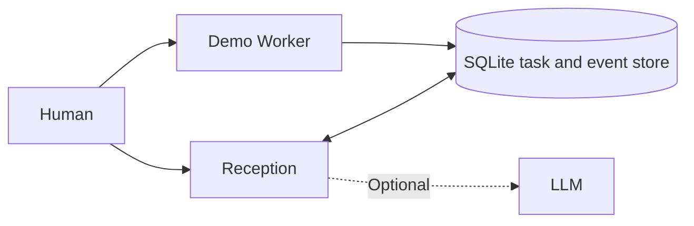

# Architecture (v0.1)

Reception reads durable task state and serves chat requests independently. The demo Worker is an asyncio task running in the same server process. Ideas are recorded without altering the active task.

## Constraints and limitations

- This is a non-blocking conversation demonstration, not autonomous real research.
- There is no sandbox, task-resume engine, authentication, or multi-worker scheduler.
- On restart, unfinished tasks are marked interrupted; they are **not** automatically resumed.
- Do not expose the server to the public internet.
- Optional model-provider use sends chat messages and brief task context to the external service.
- Reception cannot infer a Worker's private reasoning from status events.

## Next milestones

1. Intent routing and task-scoped dialogue.
2. Durable queues and safe checkpoints.
3. Explicit, reviewed task changes.
4. Isolated real-work tool adapters and independently reviewable outputs.
